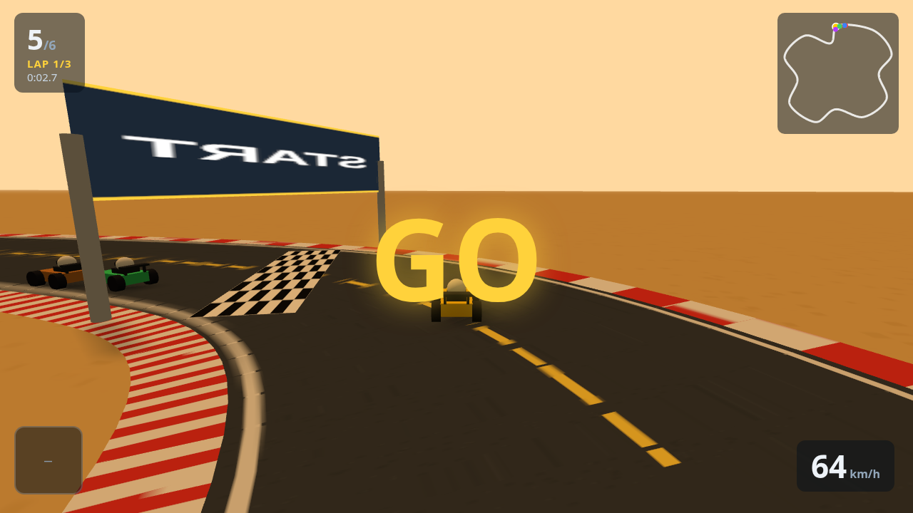

# Kart Racer

A 3-lap arcade kart racing game in the spirit of Mario Kart / Diddy Kong Racing.
Built with vanilla JS and [Three.js](https://threejs.org/) — no build step.



## Run it

Serve the folder over HTTP (ES modules don't load from `file://`):

```sh
python3 -m http.server 8000
# or: npm start
```

Then open http://localhost:8000

## Controls

| Key | Action |
| --- | --- |
| W / Up | Accelerate |
| S / Down | Brake / reverse |
| A / D, Left / Right | Steer |
| Shift | Drift (sharper turns, slides) |
| Space | Use item |
| R | Restart race |
| Esc | Back to menu |

## Features

- **3 maps**, each with its own look, layout and hazards:
  - **Meadow Rush** — easy green circuit
  - **Desert Dunes** — technical hairpins, more boost pads
  - **Frostbite Ridge** — slippery ice patches
- **5 AI rivals** with rubber-banding so races stay close
- **Items**: mushroom boost, banana bombs, shield — item boxes refill, better items when you're further back
- **Boost pads** on every track
- **Drifting**, off-road slowdown, kart-to-kart collisions
- **3 laps**, live position, lap banners, minimap, race results
- Procedural textures (road, curbs, start line), decorations, clouds, chase camera, synth sound effects

## Project layout

```
index.html      page + UI overlay + import map
css/style.css   menu / HUD / results styling
lib/            vendored three.js
src/main.js     bootstrap, renderer, camera, game states
src/race.js     race manager: countdown, laps, positions, results
src/track.js    track world: road ribbon, curbs, decorations, textures
src/tracks.js   the 3 track definitions (layout + theme)
src/kart.js     kart mesh + arcade physics
src/ai.js       AI drivers + AI item usage
src/items.js    item boxes, bananas, boost pads
src/input.js    keyboard state
src/audio.js    WebAudio synth effects
src/ui.js       menu, HUD, minimap, countdown, results
```
